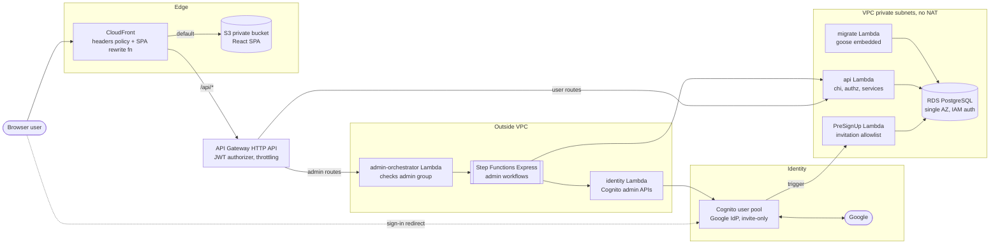
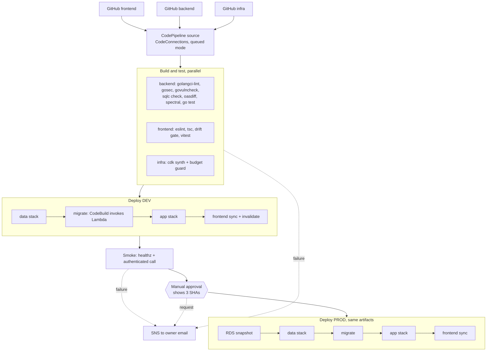
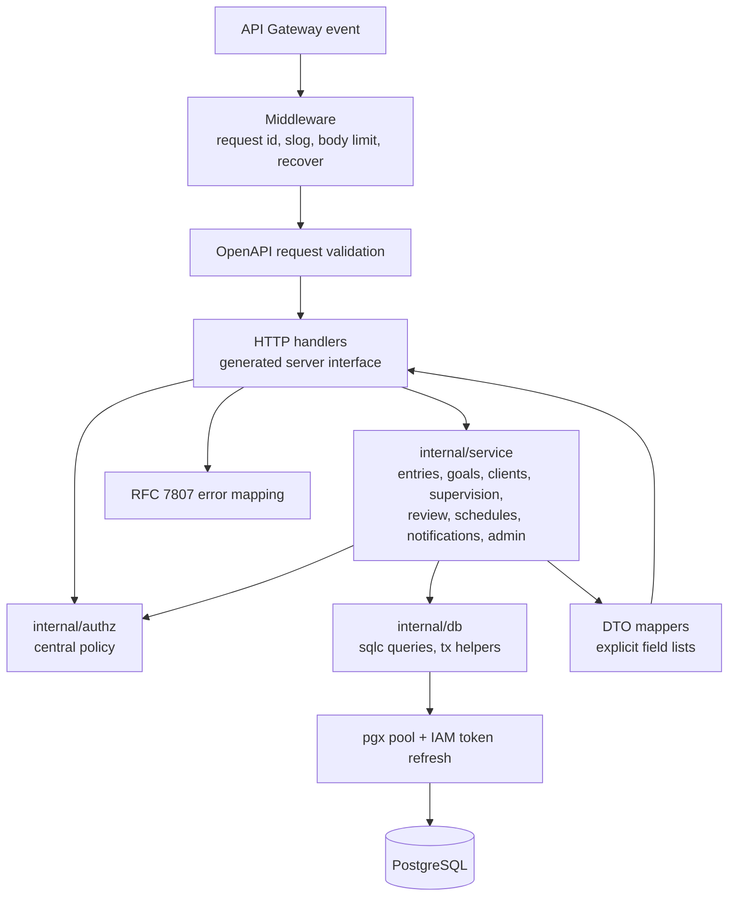
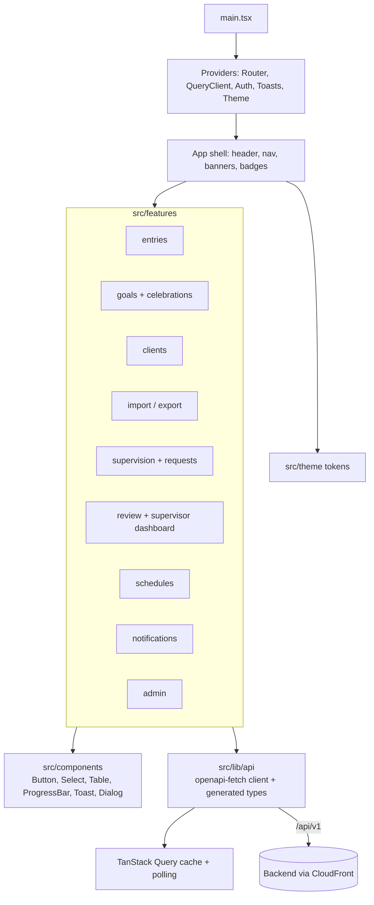
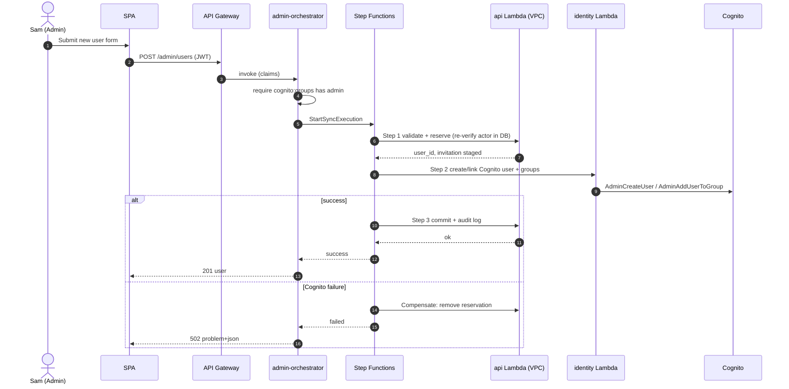
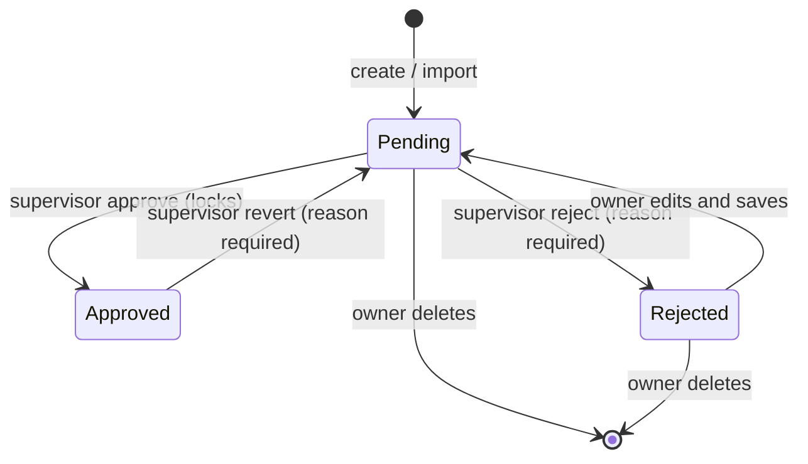
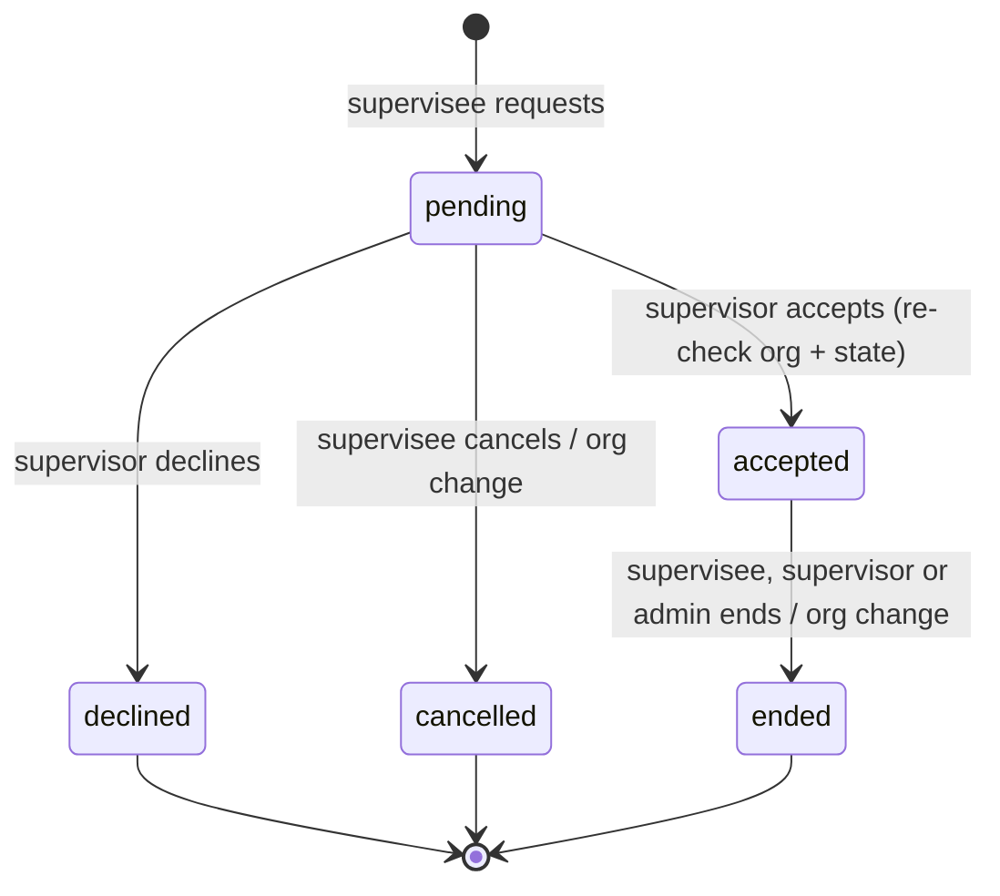
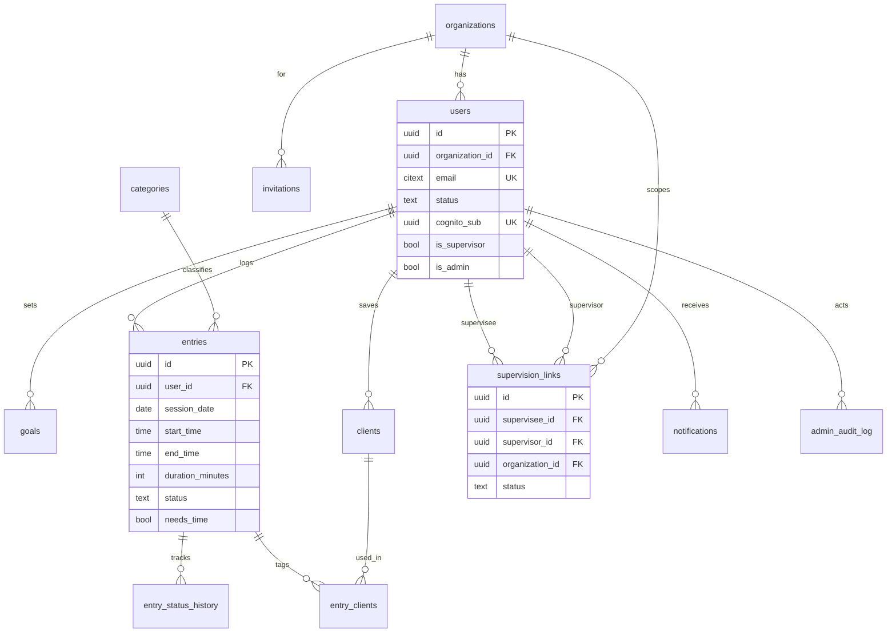
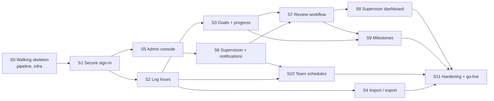

# 04. Architecture Diagrams (Mermaid)

Diagrams render on GitHub and in most Markdown viewers. They reflect `CLAUDE.md` **plus** the refinements in ADR-0001 to ADR-0006 (marked *ADR*).

## 1. System component diagram

> **PreSignUp note:** the trigger must read the `invitations` table in the private DB, so it runs **in the VPC** (Cognito invokes Lambdas through the Lambda service, no internet needed) and connects with IAM auth (ADR-0001) as a read-only role. Ticket S1-03 builds and tests this.

## 2. Pipeline and environments *(ADR-0003, ADR-0005)*

## 3. Backend internals

## 4. Frontend internals

## 5. Admin action sequence: create user *(ADR-0002)*

## 6. Entry lifecycle *(FR-REV-*)*

## 7. Supervision link lifecycle

## 8. Entity relationship diagram

## 9. Vertical slice dependency graph

