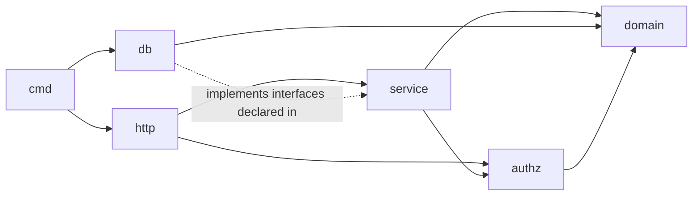

# Go Coding Standards

> **Applies to:** `therapy_service_hours_backend` (all Lambdas: `api`, `migrate`, `identity`, `admin-orchestrator`, `presignup`).
> **Status:** Adopted 2026-10-10 · **Owner:** project owner · **Related:** CLAUDE.md §2, §3.1, §9–§11, §14 · ADR-0001, ADR-0002, ADR-0003, ADR-0006

## 0. How to read this document

| Keyword | Meaning |
|---|---|
| **MUST** / **MUST NOT** | Blocking. A PR that breaks it is not merged. Most are enforced by CI. |
| **SHOULD** / **SHOULD NOT** | Expected. A deviation needs a one-line reason in the PR description. |
| **MAY** | Optional, at the author's judgement. |

Each rule has an ID (`GO-NN`) so reviewers can cite it in comments (for example "GO-31: wrap this error").

**Tools and libraries:** only the ones already decided in CLAUDE.md (chi, pgx, sqlc, goose, oapi-codegen, slog, Testcontainers) are pre-approved. Adding any other module needs a justification in the PR (GO-90).

---

## 1. Project layout and dependency direction

```
cmd/<lambda>/main.go      Composition root: read config, build dependencies, start handler
internal/config/          Typed configuration, parsed and validated once at startup
internal/domain/          Entities, value objects, domain errors. Imports nothing internal.
internal/service/<area>/  Use cases and business rules. Depends on domain + interfaces it declares.
internal/authz/           Central authorization policy (single source of truth)
internal/http/            chi router, middleware, oapi-codegen server impl, DTO mapping, error mapping
internal/db/              sqlc output + store adapters that implement service interfaces + IAM auth pool
internal/identity/        Cognito adapter (identity Lambda only)
api/openapi.yaml          Contract (ADR-0006)
db/migrations/ db/queries/
```

**Dependency rule (MUST):** arrows point inward only.



| ID | Rule |
|---|---|
| GO-01 | **MUST:** `internal/domain` imports no other `internal/*` package and no driver, HTTP or AWS SDK package. |
| GO-02 | **MUST:** `internal/service` never imports `internal/http`, `internal/db`, pgx, chi or the AWS SDK. It talks to storage and AWS through interfaces it declares. |
| GO-03 | **MUST:** `cmd/*/main.go` is the only place that wires concrete implementations together. Keep it short and free of business logic. |
| GO-04 | **MUST NOT:** use package-level mutable state, `init()` with side effects, or singletons for dependencies (DB pool, clock, clients). |
| GO-05 | **SHOULD:** one package per business area (`entries`, `goals`, `supervision`, `schedules`, `admin`, `importexport`, `notifications`). Do not create `utils` or `common` packages; name a package after what it provides. |

Enforce GO-01/GO-02 with `depguard` rules in `.golangci.yml`.

---

## 2. SOLID in Go

Go has no classes, but SOLID still applies through packages, structs, small interfaces and explicit wiring. Each principle below has a concrete project rule and an example.

### 2.1 S: Single Responsibility Principle

*A unit has one reason to change.*

| ID | Rule |
|---|---|
| GO-10 | **MUST:** keep the three layers' jobs separate. **Handlers** decode, call authz and one service method, and encode. **Services** hold business rules and transactions. **Stores** run queries. A handler never contains a business rule; a store never decides permissions. |
| GO-11 | **SHOULD:** functions stay under about **50 lines** and **cyclomatic complexity 15** (`gocyclo`/`cyclop`). Larger means it is doing more than one thing. |
| GO-12 | **SHOULD:** one service struct per use-case area, not one "god" service. `EntryService` does not send notifications directly; it calls a `Notifier` interface. |

```go
// Good: the handler only translates between HTTP and the use case.
func (h *EntryHandler) ApproveEntry(ctx context.Context, req gen.ApproveEntryRequestObject) (gen.ApproveEntryResponseObject, error) {
    actor := authn.ActorFrom(ctx)
    entry, err := h.svc.Approve(ctx, actor, domain.EntryID(req.EntryId))
    if err != nil {
        return nil, err // mapped to problem+json in one place (GO-33)
    }
    return gen.ApproveEntry200JSONResponse(dto.EntryForOwner(entry)), nil
}
```

### 2.2 O: Open/Closed Principle

*Add behavior by adding code, not by editing working code.*

| ID | Rule |
|---|---|
| GO-13 | **SHOULD:** where a set of variants is expected to grow, use a **registry of implementations** behind an interface instead of a `switch` repeated in several places. Applies to export formats (Markdown, CSV), notification types, and goal calculators. |
| GO-14 | **MUST:** sort columns use a **fixed allowlist map** (also a security rule, SEC-24). Adding a sortable column means adding one map entry. |
| GO-15 | **SHOULD NOT:** add boolean "mode" parameters to existing functions to change their behavior. Add a new function or a new implementation instead. |

```go
type Exporter interface {
    Format() domain.ExportFormat
    Write(w io.Writer, ledger domain.Ledger) error
}

// Adding a format = adding a type and one registry line. Existing exporters are untouched.
func NewExportService(exps ...Exporter) *ExportService {
    m := make(map[domain.ExportFormat]Exporter, len(exps))
    for _, e := range exps {
        m[e.Format()] = e
    }
    return &ExportService{exporters: m}
}
```

### 2.3 L: Liskov Substitution Principle

*Any implementation of an interface can stand in for another without surprising the caller.*

| ID | Rule |
|---|---|
| GO-16 | **MUST:** every implementation honors the interface's documented contract, including **error semantics**. For example, a store `Get` returns `domain.ErrNotFound` (wrapped) when nothing matches. It never returns `nil, nil`. |
| GO-17 | **MUST:** test fakes behave like the real adapter. Each store interface has a **contract test suite** that runs against both the in-memory fake and the Postgres adapter (Testcontainers). |
| GO-18 | **MUST NOT:** add an implementation that panics with "not implemented" for part of an interface. If it can't implement everything, the interface is too big (see ISP). |
| GO-19 | **MUST:** document preconditions and postconditions on interface methods in the godoc comment (for example "returns `ErrConflict` if the entry is not pending"). |

### 2.4 I: Interface Segregation Principle

*Callers depend only on the methods they use.*

| ID | Rule |
|---|---|
| GO-20 | **MUST:** **declare interfaces where they are consumed** (in the service package), not where they are implemented. "Accept interfaces, return structs." |
| GO-21 | **SHOULD:** interfaces have **1–4 methods**. No single `Repository` interface covering every table. |
| GO-22 | **MUST NOT:** export an interface from `internal/db` just to mirror the sqlc `Querier`. Services define the narrow view they need. |

```go
// internal/service/schedules: only what this use case needs.
type PeerScheduleReader interface {
    PeerWeek(ctx context.Context, target domain.UserID, weekStart domain.Date) ([]domain.ScheduleBlock, error)
}
type PeerResolver interface {
    SharesSupervisor(ctx context.Context, a, b domain.UserID) (bool, error)
}
```

### 2.5 D: Dependency Inversion Principle

*High-level policy depends on abstractions; details are injected.*

| ID | Rule |
|---|---|
| GO-23 | **MUST:** services receive every dependency through a constructor (`NewXService(deps...)`). This includes the store, `Clock`, `IDGenerator`, `Notifier`, and the `TxRunner`. |
| GO-24 | **MUST:** business code never calls `time.Now()`, `uuid.New()` or `rand` directly. Use the injected `Clock` and `IDGenerator`, so tests are deterministic (milestones, token expiry, week calculations). |
| GO-25 | **SHOULD:** constructors validate required dependencies and return an error rather than accepting `nil` and failing later. |
| GO-26 | **MAY:** use plain manual wiring in `main.go`. A DI framework is **not** needed at this size and is not pre-approved. |

---

## 3. Formatting, naming and comments

| ID | Rule |
|---|---|
| GO-27 | **MUST:** `gofmt` and `goimports` clean. CI fails otherwise. |
| GO-28 | **MUST:** follow Effective Go naming. Use `MixedCaps`, short receiver names, no `Get` prefix on getters, and initialisms in caps (`userID`, `HTTPClient`). |
| GO-29 | **MUST:** every exported identifier has a godoc comment that starts with its name. Comments explain **why**, not what. |
| GO-30 | **SHOULD:** use domain types (`domain.UserID`, `domain.OrgID`, `domain.EntryID`) instead of bare `uuid.UUID` or `string`, so IDs of different kinds cannot be swapped by accident. |

---

## 4. Errors

| ID | Rule |
|---|---|
| GO-31 | **MUST:** wrap errors with context using `fmt.Errorf("approve entry %s: %w", id, err)`. Never discard an error (`errcheck`). |
| GO-32 | **MUST:** business failures are **domain errors** in `internal/domain` (`ErrNotFound`, `ErrForbidden`, `ErrConflict`, `ErrValidation` with field details, `ErrLastAdmin`, `ErrOverlap`). Check them with `errors.Is` and `errors.As`, never by comparing strings. |
| GO-33 | **MUST:** map domain errors to HTTP status and RFC 7807 `problem+json` in **one place** (`internal/http/errors.go`). Unknown errors become a generic 500 with only the request ID. Never return internal error text, SQL or stack traces to clients. |
| GO-34 | **MUST:** map Postgres constraint violations (unique, exclusion, check) to domain errors in the store adapter. For example, the overlap exclusion constraint maps to `ErrOverlap`. Services never inspect `pgconn.PgError`. |
| GO-35 | **MUST NOT:** `panic` in request paths. Panics are allowed only for unrecoverable startup misconfiguration. A recovery middleware logs and returns 500. |
| GO-36 | **SHOULD:** return `ErrNotFound`, not `ErrForbidden`, when the actor may not know the resource exists. This avoids revealing other users' IDs (IDOR hardening). |

---

## 5. Context, concurrency and Lambda lifecycle

| ID | Rule |
|---|---|
| GO-37 | **MUST:** `ctx context.Context` is the first parameter of any function that does I/O. Never store a context in a struct. |
| GO-38 | **MUST:** pass the Lambda/request context down to every DB and AWS call so timeouts cancel work. |
| GO-39 | **MUST:** create expensive clients (pgx pool, AWS SDK clients, config) **once per cold start** in `main`, not per request. |
| GO-40 | **MUST:** pgx pool `MaxConns = 2` per instance; the API Lambda has reserved concurrency (ADR-0001). Do not raise either without checking the `db.t4g.micro` connection budget. |
| GO-41 | **SHOULD NOT:** start goroutines in handlers. If you need one, it must be bounded, receive the context, and be awaited before the handler returns. A Lambda freezes after it returns. |
| GO-42 | **MUST:** code passes `go test -race`. |

---

## 6. Database access (sqlc + pgx)

These rules carry out the non-negotiable parameterized-query requirement (CLAUDE.md §11.1, SEC-20 to SEC-27).

| ID | Rule |
|---|---|
| GO-43 | **MUST:** all SQL lives in `db/queries/*.sql` and runs through sqlc-generated code with bound parameters. **No SQL strings in Go.** |
| GO-44 | **MUST:** optional filters use `sqlc.narg()` in a single static query (`WHERE (sqlc.narg(status)::text IS NULL OR status = sqlc.narg(status))`). |
| GO-45 | **MUST:** multi-statement use cases run inside one transaction through an injected `TxRunner` (`WithTx(ctx, func(q Queries) error)`). Transactions never span a network call to AWS (ADR-0002 uses Step Functions steps instead). |
| GO-46 | **MUST:** state transitions use **conditional updates** (`UPDATE … WHERE id = $1 AND status = 'pending' RETURNING …`) and treat zero rows as `ErrConflict`. This makes concurrent approvals, bulk approvals and step retries safe. |
| GO-47 | **MUST:** every query on user data is scoped by the actor's relationship (owner, accepted supervisor, peer, org) **in the SQL**, as well as by authz. |
| GO-48 | **MUST:** session dates and times use civil (no timezone) types, `domain.Date` and `domain.LocalTime`, mapped to Postgres `date` and `time`. Never convert them through `time.Location`. All other timestamps are `timestamptz` in UTC. |
| GO-49 | **MUST:** CI runs `sqlc diff` (or `sqlc generate` followed by `git diff --exit-code`) so generated code is never stale. |
| GO-50 | **MUST:** migrations follow ADR-0003: forward-only, additive first, destructive statements only in files tagged `-- +contract`, each migration safe to run before the new code is live. |
| GO-51 | **SHOULD:** every new query on a hot path (entries list, schedule week, supervisor summary) has its `EXPLAIN` plan checked against the indexes in CLAUDE.md §9. |

---

## 7. HTTP and API

| ID | Rule |
|---|---|
| GO-52 | **MUST:** interface first. Change `api/openapi.yaml`, regenerate with `oapi-codegen` (strict server), then implement. Handlers implement the generated interface (ADR-0006). |
| GO-53 | **MUST:** request validation middleware validates against the spec. Services still validate business rules (15-minute steps, end after start, Monday `weekStart`). |
| GO-54 | **MUST:** responses are built by **explicit DTO mapping functions** per audience (`dto.EntryForOwner`, `dto.EntryForSupervisor`, `dto.ScheduleBlockForPeer`). Never encode a domain or sqlc struct directly. |
| GO-55 | **MUST:** the server computes hours from start and end. A request that includes an hours field is rejected with 400. |
| GO-56 | **MUST:** list endpoints paginate (default 50, maximum 200) and return a stable order with a tiebreaker on `id`. |
| GO-57 | **MUST:** create and bulk POST endpoints honor `Idempotency-Key`. A repeated key with the same body returns the original result; with a different body it returns 409. |
| GO-58 | **SHOULD:** handlers set timeouts below the Lambda timeout so a slow DB returns a clean 503 problem, not a Lambda timeout. |

---

## 8. Authorization in code

| ID | Rule |
|---|---|
| GO-59 | **MUST:** every service method that touches user data calls `internal/authz` **before** doing work: `authz.Can(actor, action, resource)`. Hand-rolled role checks in handlers or services are rejected in review. |
| GO-60 | **MUST:** authz is **deny by default**. Each action is an explicit `const` and an explicit rule. An unknown action returns a denial. |
| GO-61 | **MUST:** supervisor and admin rights are re-checked against the database role mirror on every privileged call. Token group claims are treated as hints only (ADR-0002). |
| GO-62 | **MUST:** `internal/authz` has 100% branch coverage plus the negative tests listed in CLAUDE.md §11.2. |

---

## 9. Logging and observability

| ID | Rule |
|---|---|
| GO-63 | **MUST:** use `log/slog` with the JSON handler. Every log line carries `request_id`, `function` and, when authenticated, the internal `user_id`. |
| GO-64 | **MUST NOT:** log entry notes, client names, emails, display names, JWTs, IAM auth tokens, request bodies or SQL parameter values. Log IDs and counts instead (SEC-50). |
| GO-65 | **MUST:** log once, where an error is handled (the error-mapping layer). Do not log and also return the same error. |
| GO-66 | **SHOULD:** emit a metric or structured field for business events (entry approved, link accepted) to support CloudWatch alarms and dashboards. |
| GO-67 | **MUST:** each Lambda exposes its readiness check. The API exposes `/healthz` without touching user data. |

---

## 10. Configuration

| ID | Rule |
|---|---|
| GO-68 | **MUST:** configuration comes from environment variables set by CDK, parsed into a typed `config.Config` once at startup, and validated. Missing or invalid values fail the cold start with a clear log line. |
| GO-69 | **MUST NOT:** hard-code account IDs, ARNs, hostnames, user pool IDs or emails in Go code. |
| GO-70 | **MUST NOT:** read secrets at runtime in VPC Lambdas (ADR-0001). The identity Lambda is the only function that may read Secrets Manager, and only if a later ADR requires it. |

---

## 11. Testing

| ID | Rule |
|---|---|
| GO-71 | **MUST:** business rules have **table-driven** unit tests (lifecycle transitions, overlap rules, 15-minute steps, goal math, milestone crossing, week boundaries). |
| GO-72 | **MUST:** store adapters and migrations are tested against **real Postgres via Testcontainers**, never an in-memory substitute. |
| GO-73 | **MUST:** every endpoint that accepts text, search or sort input is covered by the injection payload suite (validation plan §5). |
| GO-74 | **MUST:** authz negative tests exist for every new route (cross-org, non-peer, non-supervisee, non-admin, admin without a link). |
| GO-75 | **SHOULD:** call `t.Parallel()` in unit tests. Integration tests use one container per package and isolate data by transaction or schema. |
| GO-76 | **MUST:** test fixtures use **fictional pseudonyms only** (CLAUDE.md §0.7). |
| GO-77 | **SHOULD:** coverage of 80% or more for `internal/service` and `internal/authz` (100% branches for authz, GO-62). Coverage is a floor, not a goal; review the tests, not just the number. |
| GO-78 | **SHOULD:** test names describe behavior, for example `TestApprove_RejectsWhenEntryAlreadyApproved`. |

---

## 12. Lint configuration (`.golangci.yml`)

**MUST** enable at least: `errcheck`, `govet`, `staticcheck`, `ineffassign`, `unused`, `gosec`, `revive`, `gocritic`, `errorlint`, `wrapcheck` (on adapter packages), `bodyclose`, `contextcheck`, `noctx`, `depguard` (GO-01/GO-02), `cyclop` (max 15), `gofmt`, `goimports`, `misspell`.

`//nolint` comments **MUST** name the linter and give a reason: `//nolint:gosec // G115: value bounded by validation above`.

---

## 13. Dependencies

| ID | Rule |
|---|---|
| GO-90 | **MUST:** a new module dependency needs a PR note covering why the standard library or an approved module isn't enough, its maintenance status, licence (MIT, BSD or Apache-2.0 preferred), and its size impact on the Lambda binary. |
| GO-91 | **MUST:** `govulncheck` passes in CI. `go.mod` pins the Go toolchain version. |
| GO-92 | **SHOULD:** build with `-trimpath -ldflags="-s -w"` and `CGO_ENABLED=0` for `provided.al2023` arm64 (Graviton) binaries. |

---

## 14. Go review checklist

- [ ] Layer boundaries respected (GO-01, GO-02, GO-10)
- [ ] New behavior added through new implementations or registry entries, not edits to switches (GO-13)
- [ ] Interfaces are small and declared by the consumer (GO-20, GO-21)
- [ ] Clock, ID generator and stores are injected; no `time.Now()` in services (GO-23, GO-24)
- [ ] Errors are wrapped, domain errors used, and nothing internal leaks (GO-31 to GO-34)
- [ ] SQL is in `.sql` files, bound parameters only, and transitions are conditional (GO-43 to GO-47)
- [ ] OpenAPI changed first; DTOs are explicit per audience (GO-52, GO-54)
- [ ] `authz` called; negative tests added (GO-59, GO-74)
- [ ] No sensitive values logged (GO-64)
- [ ] Unit, integration and injection tests added; fixtures fictional (GO-71 to GO-76)
