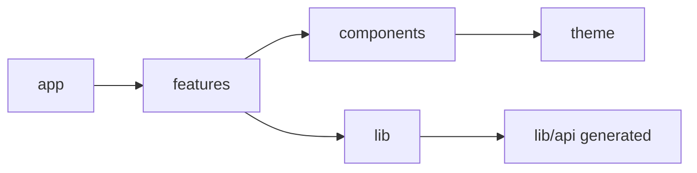

# React and TypeScript Coding Standards

> **Applies to:** `therapy_service_hours_frontend` (React + TypeScript SPA, Vite, TanStack Query, React Router, served from S3 + CloudFront).
> **Status:** Adopted 2026-10-10 · **Owner:** project owner · **Related:** CLAUDE.md §2, §3.1, §7, §12, §14 · ADR-0004, ADR-0006

## 0. How to read this document

| Keyword | Meaning |
|---|---|
| **MUST** / **MUST NOT** | Blocking. A PR that breaks it is not merged. Most are enforced by `eslint`, `tsc` or tests. |
| **SHOULD** / **SHOULD NOT** | Expected. A deviation needs a one-line reason in the PR description. |
| **MAY** | Optional. |

Rules have IDs (`FE-NN`) for review comments.

**Libraries:** React, React Router, TanStack Query, `openapi-typescript`, `openapi-fetch`, MSW, React Testing Library and Playwright are decided (CLAUDE.md, ADR-0006). Anything else, including a form library, a UI kit, a global state store, a date library or the browser PDF library, needs a justification in the PR (FE-80). Items marked **Default** below are sensible defaults you can change.

---

## 1. Project layout and dependency direction

```
src/app/            Shell, routes, providers (QueryClient, auth, theme), error boundaries
src/features/<f>/   entries, goals, clients, schedules, supervision, admin, notifications, importexport
   api/             Query and mutation hooks, query keys (the only place that calls the API client)
   components/      Feature UI
   hooks/           Feature logic hooks
   model/           Pure functions and view types (formatting, mapping, calculations)
   index.ts         Public surface of the feature
src/components/     Shared, feature-agnostic UI (Button, Dialog, Toast, ProgressBar, DataTable)
src/lib/api/        Generated types, typed client, pinned openapi.yaml (ADR-0006)
src/lib/            Cross-cutting helpers (dates, auth session, http errors)
src/theme/          Design tokens (CLAUDE.md §12.2) as CSS custom properties
```



| ID | Rule |
|---|---|
| FE-01 | **MUST:** a feature imports another feature only through its `index.ts`, never its internals (`eslint-plugin-boundaries` or `import/no-restricted-paths`). |
| FE-02 | **MUST:** `src/components` and `src/lib` never import from `src/features` or `src/app`. |
| FE-03 | **MUST:** only `features/*/api` calls the API client. Components never call `fetch`. |
| FE-04 | **SHOULD:** one component per file, `PascalCase.tsx`. Hooks are `useThing.ts`. Use **named exports**; default exports are allowed only for route modules that are lazy loaded. |

---

## 2. SOLID in React

React favors composition and functions over classes. SOLID maps onto components, hooks and modules like this.

### 2.1 S: Single Responsibility Principle

*Each component or hook has one reason to change.*

| ID | Rule |
|---|---|
| FE-10 | **MUST:** separate **data** (query hooks in `api/`), **logic** (hooks and pure functions in `hooks/` and `model/`) and **presentation** (components). A presentational component receives data and callbacks through props and does not fetch. |
| FE-11 | **SHOULD:** a component file stays under about **150 lines**. If it is longer, extract subcomponents or a hook. |
| FE-12 | **SHOULD:** put calculations (hours from times, goal percentages, week ranges) in **pure functions** in `model/` with unit tests, not inline in JSX. |

```tsx
// Container: wires data to the view.
export function EntriesPanel() {
  const filters = useEntryFilters();            // URL-driven state (FE-31)
  const query = useEntriesQuery(filters.value); // data
  return <EntriesTable state={query} filters={filters} />;
}

// Presentational: renders only. Easy to test with fixtures.
export function EntriesTable({ state, filters }: EntriesTableProps) { /* … */ }
```

### 2.2 O: Open/Closed Principle

*Extend components without editing them.*

| ID | Rule |
|---|---|
| FE-13 | **MUST:** use **composition** (`children` and slot props) for layout variation, not boolean flags. `<Card header={…} actions={…}>` rather than `<Card showHeader showActions isCompact>`. |
| FE-14 | **SHOULD:** drive variants from **configuration maps**. Status chips, category badges and goal bar colors come from typed maps keyed by the generated enum. A new status or category is one map entry. |
| FE-15 | **SHOULD NOT:** add a new prop to a shared component for one caller's special case. Compose a wrapper in the feature instead. |

```tsx
const statusChip: Record<EntryStatus, { label: string; tone: Tone }> = {
  pending:  { label: "Pending",  tone: "gold" },
  approved: { label: "Approved", tone: "lime" },
  rejected: { label: "Rejected", tone: "red"  },
};
// `satisfies Record<EntryStatus, …>` makes tsc fail if a new status is added to the spec but not here.
```

### 2.3 L: Liskov Substitution Principle

*A wrapper can be used anywhere the element it wraps can.*

| ID | Rule |
|---|---|
| FE-16 | **MUST:** shared primitives **extend native element props** and forward refs, so they are drop-in replacements: `type ButtonProps = ComponentPropsWithoutRef<"button"> & { variant?: Variant }`. |
| FE-17 | **MUST:** wrappers keep native semantics. A `Button` renders a `<button>` with `type="button"` by default, still fires `onClick` and still respects `disabled`. A `Link` renders an `<a>`. Never fake a button with a `div`. |
| FE-18 | **MUST:** components that implement a shared props contract (for example every `Field` takes `label`, `error` and `id`) behave the same way: same error display, same `aria-describedby` wiring. |

### 2.4 I: Interface Segregation Principle

*Props ask only for what the component uses.*

| ID | Rule |
|---|---|
| FE-19 | **SHOULD:** pass the fields a component needs, not a whole API object. `<ScheduleBlock start end category />` rather than `<ScheduleBlock entry={entry} />`. This also stops private fields from flowing into peer views. |
| FE-20 | **SHOULD:** split a hook that returns many unrelated values into focused hooks (`useEntryFilters`, `useEntrySort`, `useEntrySelection`). |
| FE-21 | **SHOULD:** use **view types** (`Pick<>` or explicit types in `model/`) for presentational props instead of generated API types when the component only needs part of them. |

### 2.5 D: Dependency Inversion Principle

*Components depend on abstractions; concrete services are provided from outside.*

| ID | Rule |
|---|---|
| FE-22 | **MUST:** components depend on **hooks** (`useApproveEntry()`), not on the HTTP client, Cognito SDK or `window` APIs directly. |
| FE-23 | **MUST:** cross-cutting services (API client, auth session, clock, toast) are provided through React context at `src/app` and consumed through hooks. Tests swap them with test providers. |
| FE-24 | **MUST:** mock the API at the **network boundary with MSW**, not by mocking modules, so tests exercise the real hooks and client (ADR-0006). |
| FE-25 | **SHOULD:** read "today" and "this week" through an injectable `useClock()`, so schedule and milestone tests are deterministic. |

---

## 3. TypeScript

| ID | Rule |
|---|---|
| FE-26 | **MUST:** `tsconfig` has `strict`, `noUncheckedIndexedAccess`, `exactOptionalPropertyTypes`, `noImplicitOverride` and `noFallthroughCasesInSwitch`. `tsc --noEmit` runs in CI. |
| FE-27 | **MUST NOT:** use `any`. Use `unknown` and narrow it. `@ts-ignore` is banned; `@ts-expect-error` is allowed only with a reason. |
| FE-28 | **MUST:** API types come only from the **generated** `src/lib/api` types. Never hand-write a type for a request or response (ADR-0006 drift gate). |
| FE-29 | **SHOULD:** use exhaustive `switch` with a `never` check, or `satisfies Record<Union, …>` maps, so new enum values from the spec cause compile errors. |
| FE-30 | **SHOULD:** use non-null assertions (`!`) only with a comment explaining why the value can't be null. |

---

## 4. State and data fetching

| ID | Rule |
|---|---|
| FE-31 | **MUST:** choose state in this order: **server state** goes in TanStack Query, **shareable view state** (filters, sort, selected user, week) goes in **URL search params**, **ephemeral UI state** goes in component state. A global client store is not pre-approved. |
| FE-32 | **MUST:** each feature has a **query key factory** (`entryKeys.list(filters)`, `entryKeys.detail(id)`). Mutations invalidate exact keys. Never use ad-hoc string keys. |
| FE-33 | **MUST:** every data view handles **loading, error, empty and "no matches"** states explicitly, plus a per-route **error boundary**. |
| FE-34 | **MUST:** respect API contracts. Use pagination parameters, honor `429` and `Retry-After`, and send an `Idempotency-Key` on create and bulk mutations (one generated key per user action, reused on retry). |
| FE-35 | **SHOULD:** use optimistic updates only for low-risk, owner-only changes. **Approve, reject, revert and admin actions MUST wait for the server**, because they are audited and can fail on authorization or concurrency. |
| FE-36 | **MUST:** notification polling uses `refetchInterval` (about 60 seconds) plus refetch on focus, and pauses when the tab is hidden (CLAUDE.md §6.3). |
| FE-37 | **MUST:** show server `problem+json` errors to the user in plain language, and map field errors to the matching inputs. Never show raw error payloads. |

---

## 5. Forms and input

| ID | Rule |
|---|---|
| FE-38 | **MUST:** every input has a programmatic label. Errors are linked with `aria-describedby` and announced, using the toast or an inline live region. |
| FE-39 | **MUST:** the entry form never sends hours. It shows calculated hours read-only from start and end (CLAUDE.md §7.1). |
| FE-40 | **MUST:** client-side validation mirrors the spec (15-minute steps, end after start, no midnight crossing) for fast feedback, but the **server is the authority**. |
| FE-41 | **MUST:** client and notes fields show the **pseudonyms-only warning** (CLAUDE.md §11.3). |
| FE-42 | **Default:** controlled inputs with a small `useForm`-style hook in the feature. Adopting a form library needs FE-80 justification. |

---

## 6. Styling and theme

| ID | Rule |
|---|---|
| FE-43 | **MUST:** colors, fonts, spacing and radii come from **theme tokens** (CSS custom properties in `src/theme`). No hex values in components; lint with `stylelint` `color-no-hex` outside `src/theme`. |
| FE-44 | **MUST:** text contrast is at least **4.5:1** (WCAG AA). New token pairs get a contrast unit test. |
| FE-45 | **MUST:** fonts (Fredoka, Inter) are **self-hosted** to satisfy the CSP (ADR-0004). Numbers use tabular figures. |
| FE-46 | **MUST NOT:** use inline `style` attributes or runtime-injected `<style>` tags that the CSP blocks. Dynamic values (column widths, progress) go through CSS variables set on the element (`style={{ "--pct": … }}` is allowed only for custom properties). |
| FE-47 | **Default:** CSS Modules for component styles. |

---

## 7. Accessibility

| ID | Rule |
|---|---|
| FE-48 | **MUST:** use semantic HTML first (`<button>`, `<table>`, `<nav>`, headings in order). Add ARIA only when no native element fits. |
| FE-49 | **MUST:** sortable headers are `<button>` elements inside `<th>` with `aria-sort`. Progress bars use `role="progressbar"` with `aria-valuetext`. |
| FE-50 | **MUST:** everything works by keyboard, with a visible focus ring (red-deep, 2px). Dialogs trap and restore focus. |
| FE-51 | **MUST:** respect `prefers-reduced-motion`, including confetti and transitions. |
| FE-52 | **MUST:** run `axe` in component tests and Playwright for key pages. No serious or critical violations are allowed (validation plan). |
| FE-53 | **MUST:** the schedule grid collapses to a day list on narrow screens, and both views are keyboard navigable. |

---

## 8. Performance

| ID | Rule |
|---|---|
| FE-54 | **MUST:** lazy-load routes with `React.lazy`. **Admin, supervisor and Team Schedules** pages are separate chunks. |
| FE-55 | **MUST:** the browser PDF library is loaded with a **dynamic `import()`** only when the user exports a PDF. |
| FE-56 | **Default:** initial JS for the sign-in and entries route is **250 KB gzip or less**, checked in CI with a bundle-size report. Change the budget if needed, but keep a budget. |
| FE-57 | **SHOULD:** measure before memoizing. Use `useMemo` and `memo` for expensive derivations or large lists, not by reflex. |
| FE-58 | **SHOULD:** debounce search inputs (about 300 ms) for supervisor and peer search, and cancel stale queries. |
| FE-59 | **SHOULD:** reserve layout space for loading states (skeletons with fixed heights) to avoid layout shift. |

---

## 9. Frontend security

Summary here; full rules in the [security standards](04-security-standards.md).

| ID | Rule |
|---|---|
| FE-60 | **MUST NOT:** use `dangerouslySetInnerHTML`, `eval`, `new Function` or `innerHTML`. Notes and client names render as text only. |
| FE-61 | **MUST NOT:** store tokens in `localStorage` or `sessionStorage`. Tokens live in memory, managed by the auth module in `src/lib`; a reload re-authenticates silently through the hosted-UI session cookie (ADR-0008). Sign-out revokes the refresh token, and a callback carrying `error`/`error_description` routes to the access-denied page. |
| FE-62 | **MUST:** the SPA calls only same-origin `/api/v1/...` (ADR-0004). No hard-coded API hosts, and no third-party runtime scripts or CDNs. |
| FE-63 | **MUST NOT:** put sensitive data (notes, client names) in URLs, analytics or console logs. URL state holds IDs and dates only. |
| FE-64 | **MUST:** hide UI by role for convenience only. The server enforces every permission, and the UI must not rely on hiding. |

---

## 10. Testing

| ID | Rule |
|---|---|
| FE-65 | **MUST:** React Testing Library tests assert **user-visible behavior**. Query by role, label or text, never by class name or test ID unless nothing else works. |
| FE-66 | **MUST:** use MSW handlers typed from generated types, with a test that every spec path has a handler or an explicit exemption (ADR-0006). |
| FE-67 | **MUST:** unit tests cover the pure functions in `model/` (hours math, week ranges, goal percentages, milestone detection). |
| FE-68 | **MUST:** Playwright covers the critical paths in CLAUDE.md §14. |
| FE-69 | **SHOULD NOT:** snapshot large component trees. Small, intentional snapshots (such as an export file format) are fine. |
| FE-70 | **MUST:** fixtures use fictional pseudonyms only. |
| FE-71 | **SHOULD:** coverage of 80% or more for `features/*/model` and `features/*/hooks`. |

---

## 11. Tooling

| Tool | Rule |
|---|---|
| `eslint` | **MUST:** flat config with `typescript-eslint` (strict, type-checked), `eslint-plugin-react`, `react-hooks` (rules-of-hooks and exhaustive-deps as errors), `jsx-a11y`, an import-boundary plugin (FE-01/FE-02), and `no-restricted-syntax` for FE-60. |
| Formatter | **Default:** Prettier, run in CI with `--check`. |
| `tsc` | **MUST:** `--noEmit` in CI (FE-26). |
| `npm` | **MUST:** commit `package-lock.json`, use `npm ci` in CI, and run `npm audit --audit-level=high` (validation plan). |
| Env config | **MUST:** only `VITE_` variables that are safe to be public are allowed. Per-environment values (Cognito domain, client ID) are injected at deploy time. No secrets ever reach the frontend. |

---

## 12. Dependencies

| ID | Rule |
|---|---|
| FE-80 | **MUST:** a new npm dependency needs a PR note covering why, its maintenance status, licence, **gzip size** (Bundlephobia), tree-shakability (ESM), and whether a small native utility would do. |
| FE-81 | **SHOULD:** prefer platform APIs (`Intl.DateTimeFormat`, `Intl.NumberFormat`, `URLSearchParams`, `crypto.randomUUID`) over libraries. |

---

## 13. React review checklist

- [ ] Data, logic and presentation separated; component under about 150 lines (FE-10, FE-11)
- [ ] Variants come from maps or composition, not boolean props (FE-13, FE-14)
- [ ] Shared primitives extend native props and keep semantics (FE-16, FE-17)
- [ ] Props are narrow; peer views receive only whitelisted fields (FE-19)
- [ ] Services come from context and hooks; MSW used in tests (FE-22 to FE-24)
- [ ] Generated API types only; no `any` (FE-27, FE-28)
- [ ] State in the right place, with URL state for filters and schedules (FE-31)
- [ ] Loading, error, empty and no-match states handled (FE-33)
- [ ] Review actions are not optimistic (FE-35)
- [ ] Tokens only for colors; contrast is AA (FE-43, FE-44)
- [ ] Keyboard, labels, `aria-sort`, progressbar and reduced motion checked; axe passes (FE-48 to FE-52)
- [ ] Route split; PDF library dynamically imported (FE-54, FE-55)
- [ ] No `dangerouslySetInnerHTML`; nothing sensitive in URLs or logs (FE-60, FE-63)
