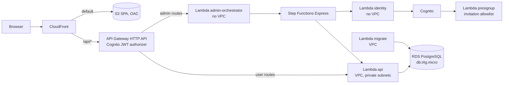

# Architecture Standards

> **Applies to:** all three repositories and the AWS environments (dev, prod) in us-west-2.
> **Status:** Adopted 2026-10-10 · **Owner:** project owner · **Related:** CLAUDE.md §2, §4, §9, §10, §13 · ADR-0001 to ADR-0006 (all Accepted)

Rules use **MUST**, **SHOULD** and **MAY** as in the coding standards, with IDs `ARC-NN`.

---

## 1. Guiding principles

| # | Principle | What it means here |
|---|---|---|
| P1 | **Managed and serverless first** | Lambda, API Gateway, Cognito, Step Functions, S3 and CloudFront. RDS is the only always-on component. |
| P2 | **Budget is a requirement** | Under **$50/month for both environments**. The budget guard (CLAUDE.md §0.6) is an architecture constraint, not a preference. |
| P3 | **The database is the source of truth** | Business invariants are enforced by Postgres constraints, with the service layer as the first line. Cognito holds identity only. |
| P4 | **Contract first** | `api/openapi.yaml` defines the system boundary (ADR-0006). |
| P5 | **Least privilege everywhere** | Per-function IAM roles, per-purpose DB roles, deny-by-default authorization. |
| P6 | **Everything as code** | All infrastructure in CDK (TypeScript). No console changes in either environment. |
| P7 | **Decisions are recorded** | A significant choice gets an ADR before it is built. |

---

## 2. Reference architecture

| ID | Rule |
|---|---|
| ARC-01 | **MUST:** keep the component boundaries above. A new component, or a new path between components, needs an ADR. |
| ARC-02 | **MUST:** VPC Lambdas have **no internet route** (no NAT) and reach only RDS. Anything that needs an AWS API runs outside the VPC (ADR-0002). |
| ARC-03 | **MUST:** the SPA and API share one origin through CloudFront. No CORS configuration on API Gateway (ADR-0004). |
| ARC-04 | **MUST:** one pipeline in the infra repo releases all three repos together, promoting the **same artifacts** from dev to prod (ADR-0005). |

---

## 3. Backend application architecture

The Go backend uses a **layered, ports-and-adapters** structure. The [Go coding standards](01-go-coding-standards.md) §1–§2 give the code-level rules.

| Layer | Responsibility | May depend on |
|---|---|---|
| **Transport** (`internal/http`) | Decode, validate against spec, call authz and a use case, map to DTO and problem+json | service, authz, domain |
| **Application** (`internal/service`) | Use cases, transactions, business rules, emitting notifications | domain, authz, its own port interfaces |
| **Domain** (`internal/domain`) | Entities, value objects, domain errors, pure rules | nothing internal |
| **Adapters** (`internal/db`, `internal/identity`) | Implement ports with pgx/sqlc or the AWS SDK | domain |

| ID | Rule |
|---|---|
| ARC-05 | **MUST:** one Go module, one binary per Lambda under `cmd/`, all sharing `internal/`. Do not split into microservices. |
| ARC-06 | **MUST:** each use case is a single DB transaction, or an explicit Step Functions workflow when it crosses Cognito and the DB (ADR-0002). |
| ARC-07 | **MUST:** business rules exist **once**, in the service and domain layers, and are backed by DB constraints. The frontend may repeat validation for user experience, never as the authority. |
| ARC-08 | **SHOULD:** derived data (goal progress, supervisor summaries) is computed with SQL aggregates at read time. Add a cached or materialized form only when measurements show the p95 target is missed. |

---

## 4. Frontend application architecture

| ID | Rule |
|---|---|
| ARC-09 | **MUST:** the SPA is static files only (no server rendering), served by CloudFront from a private S3 bucket. |
| ARC-10 | **MUST:** organize by feature, with the dependency rules in [React standards](02-react-coding-standards.md) §1. |
| ARC-11 | **MUST:** server state lives in TanStack Query; shareable view state lives in the URL. |
| ARC-12 | **MUST:** client-side routing uses the CloudFront Function rewrite on the S3 behavior only (ADR-0004). Never use distribution-wide error responses for this. |

---

## 5. API design

| ID | Rule |
|---|---|
| ARC-13 | **MUST:** REST over JSON under `/api/v1`. Resource nouns, HTTP verbs, and action sub-resources for state transitions (`POST /entries/{id}/approve`, `…/revert-approval`). |
| ARC-14 | **MUST:** **backward compatible within v1.** Only add optional fields, new endpoints or new enum values that the frontend handles. `oasdiff` blocks breaking changes unless the PR carries the breaking-change label and both sides ship in the same release (ADR-0005, ADR-0006). |
| ARC-15 | **MUST:** errors are RFC 7807 `problem+json` with a stable `type` URI per error kind, so the client can branch on the type rather than the message. |
| ARC-16 | **MUST:** all lists are paginated with a deterministic order. Limit pages to 50 by default and 200 at most. |
| ARC-17 | **MUST:** **idempotency.** Writes that create or bulk-change data accept `Idempotency-Key`. State transitions are conditional, so retries are safe. Step Functions steps are idempotent (at-least-once delivery). |
| ARC-18 | **MUST:** responses use audience-specific DTOs (owner, supervisor, peer, admin). The peer schedule DTO contains only time block and category. |
| ARC-19 | **SHOULD:** use `ETag` or `If-Match` (or an `updated_at` version field) for edit endpoints, so an edit that races a review fails with 409 instead of overwriting. |

---

## 6. Data architecture

| ID | Rule |
|---|---|
| ARC-20 | **MUST:** PostgreSQL is the system of record. Primary keys are UUIDs. Timestamps are `timestamptz` in UTC. Session dates and times are civil `date` and `time` with no timezone. |
| ARC-21 | **MUST:** enforce invariants in the schema: foreign keys, NOT NULL, CHECK (15-minute steps, end after start), exclusion constraint for overlaps, partial unique index for one active supervision link, and the org-match check on links (CLAUDE.md §9). |
| ARC-22 | **MUST:** data is keyed by internal `user_id`, never by email or Cognito `sub` (supports email changes). |
| ARC-23 | **MUST:** audit tables (`entry_status_history`, `admin_audit_log`) are **append-only**. The app role has INSERT and SELECT only on them. They keep name snapshots so history survives permanent deletion. |
| ARC-24 | **MUST:** migrations are forward-only and expand/contract, run by the migration Lambda before the app deploys, with a prod snapshot first (ADR-0003). |
| ARC-25 | **MUST:** two DB roles: `app_rw` (DML only) and `migrator` (DDL). Both use IAM authentication (ADR-0001). |
| ARC-26 | **SHOULD:** every query path in a user-facing screen has a supporting index. Check `EXPLAIN` against 20,000 entries (validation plan load profile). |

---

## 7. Infrastructure as code (CDK)

| ID | Rule |
|---|---|
| ARC-27 | **MUST:** one CDK app in the infra repo. Use **stacks by lifecycle** (data stack: network, RDS, DB roles; app stack: Lambdas, API, Step Functions, Cognito triggers; web stack: S3, CloudFront) and **constructs by concern** in `lib/app/`. |
| ARC-28 | **MUST:** environment differences live only in `config/dev.ts` and `config/prod.ts` (typed). No `if (env === "prod")` scattered through constructs. |
| ARC-29 | **MUST:** `cdk synth` runs a **budget-guard assertion** that fails if the app contains a NAT Gateway, RDS Proxy, interface VPC endpoint, ALB/NLB, Multi-AZ RDS or an extra DB instance (CLAUDE.md §0.6). |
| ARC-30 | **MUST:** stateful resources in prod use `RemovalPolicy.RETAIN` or `SNAPSHOT` and have deletion protection on. Dev may use `DESTROY`. |
| ARC-31 | **MUST:** tag every resource with `app`, `env` and `owner`. Name resources with the `therapy-service-hours-<env>-` prefix. |
| ARC-32 | **MUST NOT:** hard-code account IDs, ARNs or secret values. Use CDK references, SSM parameters or Secrets Manager references. |
| ARC-33 | **SHOULD:** run `cdk-nag` (AwsSolutions pack) in synth. Suppressions need a written reason in code. **Recommended:** confirm in S0. |
| ARC-34 | **MUST:** CDK unit tests (assertions) cover security-relevant properties: bucket public access blocked, RDS encryption on, RDS not publicly accessible, Lambda roles without `*` resources. |

---

## 8. Reliability and recovery

The **Decided** single-AZ, single-instance design trades availability for cost. These rules make that trade explicit.

| ID | Rule |
|---|---|
| ARC-35 | **MUST:** prod RDS has automated backups with **7-day retention** and point-in-time recovery, plus a snapshot before every prod migration. |
| ARC-36 | **Default targets:** prod **RPO of 5 minutes or less** (PITR) and **RTO of 4 hours or less** (restore from PITR or snapshot following the runbook). Restore is rehearsed once before go-live (S11). |
| ARC-37 | **MUST:** an AZ outage is an **accepted risk**. The app is unavailable until RDS recovers or is restored. Record this in the runbook. Multi-AZ needs owner approval because of cost. |
| ARC-38 | **MUST:** Lambda timeouts sit above the handler's own deadline (GO-58), and API Gateway throttling protects the DB connection budget together with reserved concurrency. |
| ARC-39 | **SHOULD:** the client retries idempotent GETs with backoff. Writes are retried only with the same `Idempotency-Key`. |

---

## 9. Performance and capacity

| ID | Rule |
|---|---|
| ARC-40 | **MUST:** meet the validation plan targets: **p95 under 500 ms** warm for list, aggregate and schedule endpoints at 50 users and 20,000 entries, and **cold start under 2 s**. |
| ARC-41 | **SHOULD:** Go Lambdas run on **arm64 (Graviton)** with memory tuned by measurement (start at 256 MB). |
| ARC-42 | **MUST:** hashed static assets are cached for one year as immutable; `index.html` is `no-cache` (ADR-0004). API responses are not cached at CloudFront. |

---

## 10. Observability and operations

| ID | Rule |
|---|---|
| ARC-43 | **MUST:** structured JSON logs from every function, with request ID correlation from API Gateway through Step Functions to Lambda. Log retention is 14 days in dev and 30 days in prod. |
| ARC-44 | **MUST:** CloudWatch alarms on API 5xx rate, Lambda errors and throttles, Step Functions failed executions, RDS CPU, free storage and connections, plus an **AWS Budgets** alarm. All go to the SNS alert topic. |
| ARC-45 | **SHOULD:** add OpenTelemetry or X-Ray tracing where cost is negligible (CLAUDE.md §10). |
| ARC-46 | **MUST:** a runbook covers deploy, rollback (roll forward or redeploy previous artifacts), DB restore, the RDS CA bundle update, first-admin recovery and handling an alarm. |

---

## 11. Environments and delivery

| ID | Rule |
|---|---|
| ARC-47 | **MUST:** dev and prod are built from the same code and config schema. Differences are limited to the values in `config/*.ts` (CLAUDE.md §4.2). |
| ARC-48 | **MUST:** dev deploys automatically on merge to `main`. Prod deploys only after manual approval, showing all three commit SHAs. |
| ARC-49 | **MUST:** `main` is protected in all three repos: PR required, all PR gates green, no force pushes. |
| ARC-50 | **MUST:** every slice ends in a demo that works on dev (vertical slices, execution plan). |

---

## 12. When an ADR is required

Write an ADR (template in `docs/adr/README.md`) **before** building any of these:

- A new AWS service, or a change to network paths or the VPC layout
- Anything the budget guard lists, or any change estimated at more than $2 a month
- A new runtime dependency that is security-relevant or large (auth, crypto, PDF, date handling)
- A change to the authorization model, roles, or what any audience can see
- A breaking API change or a new API style
- A data model change that is not additive (contract migrations)
- Departing from any **MUST** in these standards

---

## 13. Architecture review checklist

- [ ] Fits the reference architecture, or has an ADR (ARC-01)
- [ ] No internet path from VPC Lambdas; budget-guard assertion passes (ARC-02, ARC-29)
- [ ] Use case is one transaction or an idempotent workflow (ARC-06, ARC-17)
- [ ] Invariants enforced in the schema as well as code (ARC-21)
- [ ] API change is backward compatible or labelled and coordinated (ARC-14)
- [ ] Audience-specific DTOs (ARC-18)
- [ ] Env differences only in config; tags and naming applied (ARC-28, ARC-31)
- [ ] Alarms and logs cover the new path (ARC-43, ARC-44)
- [ ] Performance target checked for new queries (ARC-26, ARC-40)
