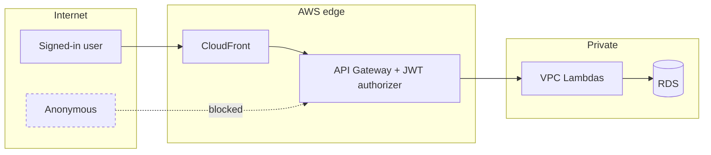

# Security Standards

> **Applies to:** all code, infrastructure, pipelines and operations for the Therapy Service Hours Tracker.
> **Status:** Adopted 2026-10-10 · **Owner:** project owner · **Related:** CLAUDE.md §0.7, §11 · NFR-SEC-* in the requirements spec · validation plan §5 · ADR-0001, ADR-0002, ADR-0004

Rules use **MUST**, **SHOULD** and **MAY**, with IDs `SEC-NN`. Every **MUST** here is non-negotiable. Departing from one needs an ADR approved by the owner.

---

## 1. Threat model summary

**Assets**

| Asset | Sensitivity | Notes |
|---|---|---|
| Entries (times, categories, notes) | Medium | Notes may contain sensitive clinical context, even with pseudonyms |
| Client and group names | Medium | **Pseudonyms or initials only** by policy; still treated as private |
| User identities (name, email, org, roles) | Medium | Personal data |
| Review decisions and audit logs | High integrity | Must not be altered or forged |
| Admin capability | High | Can change roles and delete users |
| AWS account and pipeline | Critical | Compromise means full control |

**Actors and trust boundaries**

**Top threats and their controls**

| # | Threat | Primary controls |
|---|---|---|
| T1 | A user reads or changes another user's data (IDOR, cross-org) | Central authz (SEC-10), relationship-scoped SQL (SEC-12), negative tests (SEC-16) |
| T2 | SQL injection | Bound parameters only (SEC-20 to SEC-27) |
| T3 | Privilege escalation to supervisor or admin | DB-verified roles (SEC-11), admin-only routes behind orchestrator check (SEC-14), last-admin guard |
| T4 | Data leakage in peer or supervisor views | Audience DTOs (SEC-40), leak tests (SEC-41) |
| T5 | XSS or content injection in notes, client names, imports and exports | Text-only rendering, CSP (SEC-30 to SEC-35), CSV formula escaping (SEC-37) |
| T6 | Uninvited sign-up | Self sign-up off, pre-sign-up allowlist (SEC-02) |
| T7 | Stolen credentials or secrets | No stored runtime secrets (ADR-0001), secret scanning (SEC-61), short token lifetimes (SEC-04) |
| T8 | Supply chain compromise | Lockfiles, vulnerability scans, dependency review (SEC-70 to SEC-74) |
| T9 | Abuse or denial of wallet | Throttling, body limits, budget alarm (SEC-80 to SEC-83) |

---

## 2. Identity and authentication

| ID | Rule |
|---|---|
| SEC-01 | **MUST:** sign-in is **Google only** through the Cognito hosted UI with authorization code + PKCE (OQ-01, decided 2026-10-10). No passwords are stored or handled by the app. |
| SEC-02 | **MUST:** sign-up is **invite only**. Cognito self sign-up is disabled, and the **pre-sign-up Lambda** rejects any email not in `invitations` (this covers federated first sign-ins). |
| SEC-03 | **MUST:** API Gateway's Cognito **JWT authorizer** protects every route except `/healthz`. It validates issuer, audience/client ID, expiry and signature. |
| SEC-04 | **MUST:** **Default** token lifetimes: access and ID tokens 60 minutes, refresh token 7 days. Sign-out revokes the refresh token. |
| SEC-05 | **MUST:** deactivating a user disables the Cognito user, signs them out globally, and makes the API reject them on the next request through the DB status check, even with a still-valid token. |
| SEC-06 | **MUST:** an email change ends access for the old email immediately and requires a re-invite (CLAUDE.md §5.1). |
| SEC-07 | **MUST:** the first admin is seeded at deploy time from config (`malcolmj0415@gmail.com`). No backdoor or default credentials exist. |

---

## 3. Authorization

| ID | Rule |
|---|---|
| SEC-10 | **MUST:** all permission decisions go through `internal/authz`. It is **deny by default** and checks every resource ID in a path or body against the actor's relationship (owner, accepted supervisor, peer with the same supervisor, admin). |
| SEC-11 | **MUST:** roles from token claims are **re-verified against the database** on privileged calls. Revocation takes effect immediately (ADR-0002). |
| SEC-12 | **MUST:** SQL is scoped by the actor as well (`WHERE user_id = $actor` or a join on the accepted link and org). A missing authz call cannot then expose data. |
| SEC-13 | **MUST:** admins **cannot read entries, notes or progress** unless they are also the accepted supervisor of that user. |
| SEC-14 | **MUST:** admin routes reach only the `admin-orchestrator`, which checks the `admin` group before starting a workflow. The data step re-checks the admin in the DB (ADR-0002). |
| SEC-15 | **MUST:** return **404** rather than 403 when the actor isn't allowed to know a resource exists (GO-36). |
| SEC-16 | **MUST:** every route has negative tests for: cross-org access, cross-org supervisor lookup, a non-peer schedule, a supervisor acting on a non-supervisee, a non-admin calling admin routes, an admin reading entries without a link, a deactivated user with a valid token, and a demoted admin with a valid token. |
| SEC-17 | **MUST:** guards are kept: last-admin protection, no self-supervision, one active link, same-org links enforced in the DB, locked approved entries. |

---

## 4. Input handling and injection

These rules restate and extend the parameterized-query requirement (CLAUDE.md §11.1).

| ID | Rule |
|---|---|
| SEC-20 | **MUST:** every SQL statement uses **bound parameters** through sqlc and pgx. No value from a request, token, file or environment is concatenated or formatted into SQL. |
| SEC-21 | **MUST:** no dynamic SQL in Go. Optional filters use `sqlc.narg` in static queries. |
| SEC-22 | **MUST:** CI gates: `gosec` G201/G202, a Semgrep rule forbidding `fmt.Sprintf`, `+` or `strings.Builder` output passed to `Exec`, `Query` or `QueryRow`, and an sqlc staleness check. |
| SEC-23 | **MUST:** the app DB role is least privilege (DML only, no DDL, no superuser, no access to other databases). Audit tables are INSERT and SELECT only. |
| SEC-24 | **MUST:** sort fields and directions come from a **fixed allowlist**. Anything else returns 400. |
| SEC-25 | **MUST:** `LIKE`/`ILIKE` search escapes `\`, `%` and `_`, uses an explicit `ESCAPE`, and caps the term at **64 characters**. |
| SEC-26 | **MUST:** validate all input against the OpenAPI schema (types, formats, enums, `maxLength` on every string, `maxItems` on arrays), then validate business rules in the service. **Default limits:** notes 2,000 characters, names 100, client names 64, bulk actions 200 IDs. |
| SEC-27 | **MUST:** the injection payload suite (validation plan §5) runs against every endpoint that takes text, search or sort input, and against crafted `.md` import rows. |
| SEC-28 | **MUST:** the Markdown import enforces a file size cap (**Default:** 2 MB) and a row cap (**Default:** 10,000), parses into typed values before any DB call, rejects control characters other than tab and newline, and runs in one transaction with a report. |
| SEC-29 | **MUST:** API Gateway enforces a request body size limit, and the Lambda rejects bodies over the limit before parsing. |

---

## 5. Output handling and browser security

| ID | Rule |
|---|---|
| SEC-30 | **MUST:** React renders user content as text. `dangerouslySetInnerHTML`, `innerHTML`, `eval` and `new Function` are banned by lint (FE-60). |
| SEC-31 | **MUST:** the CloudFront response headers policy sets HSTS (`max-age=31536000; includeSubDomains`), `X-Content-Type-Options: nosniff`, `Referrer-Policy: strict-origin-when-cross-origin`, `X-Frame-Options: DENY`, and a CSP of `default-src 'self'`, `connect-src 'self'` plus the Cognito domain, `img-src 'self' data:`, `object-src 'none'`, `base-uri 'self'` and `frame-ancestors 'none'` (ADR-0004). |
| SEC-32 | **MUST NOT:** add `'unsafe-inline'` or `'unsafe-eval'` to the CSP. Fonts and all scripts are self-hosted. |
| SEC-33 | **MUST:** API responses set `Content-Type: application/json` (or `application/problem+json`) and `Cache-Control: no-store`. |
| SEC-34 | **MUST:** error responses never include stack traces, SQL, internal IDs of other users, or upstream AWS error text. |
| SEC-35 | **MUST:** tokens are kept out of `localStorage` and `sessionStorage` unless spike S1-02 records an approved alternative (FE-61). |
| SEC-36 | **MUST:** the Markdown export escapes `|` and newlines in cells, so a re-import can't be broken or injected. |
| SEC-37 | **MUST:** the CSV export protects against **formula injection**. A cell starting with `=`, `+`, `-`, `@`, tab or carriage return is prefixed with `'`, and all cells are quoted with embedded quotes doubled. |
| SEC-38 | **MUST:** the PDF export is generated in the browser from already-authorized data. It never fetches remote resources. |

---

## 6. Data protection and privacy

| ID | Rule |
|---|---|
| SEC-40 | **MUST:** responses are built from **audience-specific DTOs**. The peer schedule DTO contains only date, start, end and category group. It never includes client names, notes, hours, on-site flag or status. |
| SEC-41 | **MUST:** automated tests assert that peer and supervisor responses cannot contain fields outside their whitelist. |
| SEC-42 | **MUST:** the UI shows the pseudonyms-only warning on client and notes fields, and tells users that supervisors can read notes. |
| SEC-43 | **MUST:** data is encrypted in transit (TLS 1.2 or higher everywhere, `sslmode=verify-full` to RDS) and at rest (RDS and S3 with AWS-managed KMS keys). |
| SEC-44 | **MUST:** permanent deletion removes the user's entries, clients, links, notifications and goals. Audit tables keep only the name snapshot. Backups expire within **7 days** (OQ-03, accepted 2026-10-10), and the privacy notice says so. |
| SEC-45 | **MUST:** no real client data in fixtures, seeds, tests, screenshots, logs or docs (CLAUDE.md §0.7). |

---

## 7. Logging, monitoring and audit

| ID | Rule |
|---|---|
| SEC-50 | **MUST NOT:** log notes, client names, emails, display names, tokens, IAM auth tokens, request or response bodies, or SQL parameter values. Log internal IDs, counts and outcomes. |
| SEC-51 | **MUST:** every admin action writes `admin_audit_log` (actor, action, target, details, time). Every entry status change writes `entry_status_history`. Both are append-only. |
| SEC-52 | **MUST:** log authorization denials (actor ID, action, resource type, request ID) at `warn`, and alarm on spikes. |
| SEC-53 | **MUST:** CloudTrail management events are enabled for the account (the first trail is free). Log groups have retention set (14 days dev, 30 days prod). |
| SEC-54 | **MUST:** alarms (5xx, Lambda errors, failed Step Functions runs, budget) notify the owner's SNS email. |

---

## 8. Secrets and configuration

| ID | Rule |
|---|---|
| SEC-60 | **MUST:** no secrets in code, config files, CDK context, environment variables of VPC Lambdas, logs or the frontend bundle. The Google OAuth client secret lives in Secrets Manager and is referenced by CDK. |
| SEC-61 | **MUST:** secret scanning runs as a **pre-commit hook** and in CI on all three repos. GitHub secret scanning and push protection are on where available. |
| SEC-62 | **MUST:** RDS IAM authentication for runtime DB access. The master secret is used only by the bootstrap custom resource (ADR-0001). |
| SEC-63 | **MUST:** if a secret leaks: rotate it first, then remove it from history, then record an incident note. |

---

## 9. Infrastructure and cloud

| ID | Rule |
|---|---|
| SEC-64 | **MUST:** one IAM role per Lambda with only the actions and resources it needs. No `*` resources except where AWS requires it, and then with a comment. `rds-db:connect` only for the named DB users. |
| SEC-65 | **MUST:** RDS is in private subnets, not publicly accessible. Its security group allows 5432 only from the VPC Lambda security groups. **No `0.0.0.0/0` ingress** anywhere. |
| SEC-66 | **MUST:** S3 buckets have Block Public Access on, are reachable only through CloudFront OAC, enforce TLS (`aws:SecureTransport`) and have encryption on. |
| SEC-67 | **MUST:** the CodeBuild and pipeline roles are scoped to this app's stacks. CDK bootstrap roles are not reused for unrelated work. |
| SEC-68 | **MUST:** day-to-day AWS access uses IAM Identity Center or IAM users with **MFA**. The root account has MFA and is not used for routine work. |
| SEC-69 | **SHOULD:** `cdk-nag` AwsSolutions checks pass in synth, with documented suppressions (ARC-33). |

---

## 10. Supply chain and source control

| ID | Rule |
|---|---|
| SEC-70 | **MUST:** commit lockfiles (`go.sum`, `package-lock.json`). CI uses `npm ci` and module verification. |
| SEC-71 | **MUST:** `govulncheck` and `npm audit --audit-level=high` run on every PR and nightly. A known high or critical vulnerability blocks a release unless the owner accepts the risk in writing. |
| SEC-72 | **MUST:** Dependabot (or equivalent) is on for Go modules, npm and GitHub Actions or CodeBuild images. |
| SEC-73 | **MUST:** new dependencies follow GO-90 and FE-80 (justification, licence, maintenance, size). |
| SEC-74 | **MUST:** `main` is protected in all three repos: PRs required, gates green, no force pushes. CodeConnections is limited to the three repositories. |

---

## 11. Abuse prevention and availability

| ID | Rule |
|---|---|
| SEC-80 | **MUST:** API Gateway throttling on all routes, with tighter limits on search (`/supervisors`, `/schedules/peers`) and import. |
| SEC-81 | **MUST:** the API Lambda's reserved concurrency caps DB connections (ADR-0001) and limits cost under attack. |
| SEC-82 | **MUST:** the AWS Budgets alarm fires at 80% and 100% of the monthly budget. |
| SEC-83 | **SHOULD:** consider AWS WAF only if abuse appears. It is not in v1 because of cost; the accepted risk is in ADR-0004. |

---

## 12. Secure development lifecycle

| Stage | Security activity |
|---|---|
| Design | Threat check for each slice: which assets, which audiences, which new routes. An ADR if the authz model or exposure changes. |
| Build | These standards plus the coding standards. Interface first, with audience DTOs designed in the spec. |
| PR | Automated gates (lint, `gosec`, Semgrep, `govulncheck`, `npm audit`, secret scan, tests, drift and `oasdiff`). Reviewer uses the checklist below. |
| Release | All gates green on all three release commits. Manual approval for prod. |
| Pre go-live (S11) | Full injection and authz negative suite, header and CSP check, restore rehearsal, dependency review, and a manual review against this document. |
| Operate | Alarms, nightly vulnerability scans, quarterly review of IAM, secrets and dependencies. |

**Vulnerability handling (Default):** fix critical issues within 48 hours, high within 7 days, medium in the next slice. Record each one in the backlog with the `security` label.

---

## 13. Security review checklist (every PR)

- [ ] New route: authz call, relationship-scoped SQL, 404-not-403 where appropriate, negative tests (SEC-10 to SEC-16)
- [ ] All SQL is static and parameterized; sort allowlisted; `LIKE` escaped (SEC-20 to SEC-25)
- [ ] Every new string field has `maxLength` in the spec (SEC-26)
- [ ] Response uses the right audience DTO; leak test added (SEC-40, SEC-41)
- [ ] No HTML injection paths; exports escaped (SEC-30, SEC-36, SEC-37)
- [ ] Nothing sensitive logged (SEC-50)
- [ ] No secrets added; config is not hard-coded (SEC-60)
- [ ] IAM, security group and bucket changes are least privilege (SEC-64 to SEC-66)
- [ ] New dependency justified and scanned (SEC-71, SEC-73)
